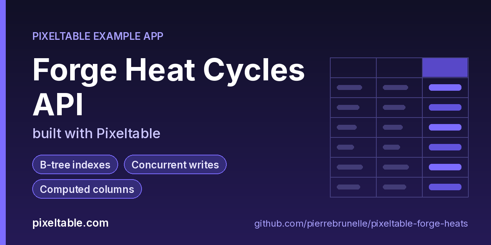

<!-- pixeltable-example-app: 20261010-forge-heats -->
# Forge Heat Cycles API built with Pixeltable



[](https://codespaces.new/pierrebrunelle/pixeltable-forge-heats?quickstart=1)
[](https://pixeltable.com)
[](https://pypi.org/project/pixeltable/)
[](https://github.com/pixeltable/pixeltable)
[](LICENSE)

A shop-floor registry of steel forge heat cycles. Log a heat with forge id, alloy, peak temperature, hold time and quench medium; Pixeltable derives a **heat band**, **risk score**, combined **heat tag** and **priority lane** through a UDF chain. Four B-tree indexes (`forge_id`, `alloy`, `status`, `band`) back the lookup queries. The HTTP API accepts inserts and status updates, scores a heat without storing it, and lists heats by forge, alloy, band+status or the hot priority lane. The client demo hammers the service with parallel writers and a status race.

[Pixeltable](https://pixeltable.com) is open-source, Python-native **multimodal AI data infrastructure**: tables, incremental computed columns, UDFs, indexes and serving in one library, running locally or on Pixeltable Cloud.

> ⭐ **Like this example?** Star [pixeltable/pixeltable](https://github.com/pixeltable/pixeltable) on GitHub. It helps other developers find it.

## What this example shows

- **B-tree indexes** declared on the model (`__indexes__`) back the lookup queries
- **Concurrent writes**: parallel HTTP clients inserting into and updating the same table
- **Incremental computed columns** powered by plain Python UDFs (`@pxt.udf`)
- **FastAPI serving**: one `FastAPIRouter` turns tables and `@pxt.query` functions into typed REST routes (insert, update, delete, compute and query) with OpenAPI docs
- **Importable UDF module**: UDFs live in `udfs.py`; tables, queries and routes live together in `app.py` (Pixeltable resolves UDFs by module path)
- **`pixeltable.toml`** declares a local database and a **Pixeltable Cloud** database, so the same code deploys with `pxt db update`

## Indexes

`Heats` declares four B-tree indexes (`forge_id`, `alloy`, `status`, `band`) that back `/heats/by-forge`, `/heats/by-alloy` and `/heats/by-band`.

## UDF chain

```
peak_c, hold_min, quench, alloy, status
        │
        ├─ heat_band(peak_c) → band
        ├─ risk_score(peak_c, hold_min, quench) → risk
        ├─ heat_tag(band, risk, alloy) → tag
        └─ priority_lane(risk, status) → lane
```

## Concurrency

`client_demo.py` fires 16 parallel inserts then 8 concurrent status updates against one `heat_id` (last writer wins).

## What's inside

| File | What it is |
|------|------------|
| `.devcontainer/devcontainer.json` | GitHub Codespaces / Dev Container config: Python 3.12, installs `requirements.txt`, forwards port 8000 |
| `.github/social-preview.png` | Social preview image (1280x640) |
| `CITATION.cff` | Citation metadata (authors, license, release date, keywords) |
| `app.py` | The app: tables declared as Python classes, `@pxt.query` functions, and the `FastAPIRouter` routes |
| `client_demo.py` | Parallel forge heat inserts + index-backed queries, then a status race on one heat |
| `pixeltable.toml` | Project config: the local database plus a Pixeltable Cloud database (sizing, deploy excludes) |
| `seed.py` | Seed a few forge heats (run after schema update) |
| `udfs.py` | Pixeltable UDFs (`@pxt.udf`) in their own importable module, imported by `app.py` |
| `requirements.txt` / `pyproject.toml` | Dependencies (`pixeltable[serve]>=0.7.16`) |

**Tables**

| Table | Stored columns | Computed columns |
|-------|---------|------------------|
| `heats` | `forge_id`, `alloy`, `status`, `peak_c`, `hold_min`, `quench`, `operator`, `note` | `heat_id`, `band`, `risk`, `tag`, `lane` |

**API routes** (service `forge_api`)

| Method | Path | Kind | Backed by | Notes |
|--------|------|------|-----------|-------|
| `POST` | `/heats` | insert | `Heats` |  |
| `POST` | `/heats/status` | update | `Heats` |  |
| `POST` | `/score` | compute | `Heats` |  |
| `POST` | `/heats/delete` | delete | `Heats` |  |
| `GET` | `/heats/by-forge` | query | `by_forge` |  |
| `GET` | `/heats/by-band` | query | `by_band_status` |  |
| `GET` | `/heats/by-alloy` | query | `by_alloy` |  |
| `GET` | `/heats/hot-lane` | query | `hot_lane` |  |

## Run in your browser (GitHub Codespaces)

[](https://codespaces.new/pierrebrunelle/pixeltable-forge-heats?quickstart=1)

1. Click **Open in GitHub Codespaces** above (or [this link](https://codespaces.new/pierrebrunelle/pixeltable-forge-heats?quickstart=1)). The dev container installs Python 3.12 and `pixeltable[serve]>=0.7.16` from `requirements.txt`.
2. In the codespace terminal, create the tables, seed them and start the API:

   ```bash
   pxt schema update app.py forge
   python seed.py forge
   pxt service run app.py forge --port 8000   # open http://localhost:8000/docs
   python client_demo.py                      # in another terminal (parallel inserts + status race)
   ```

3. Codespaces forwards port 8000: open it from the **Ports** tab (or the pop-up) and add `/docs` to the URL for the interactive OpenAPI docs.

## Quickstart

Requires Python 3.11+ and `pixeltable[serve]>=0.7.16`.

```bash
git clone https://github.com/pierrebrunelle/pixeltable-forge-heats.git
cd pixeltable-forge-heats
python -m venv .venv && source .venv/bin/activate
pip install -r requirements.txt

# Create the tables in a local catalog directory named `forge`
pxt schema update app.py forge

python seed.py forge
pxt service run app.py forge --port 8000   # open http://localhost:8000/docs
python client_demo.py                      # in another terminal (parallel inserts + status race)
```

Try it:

```bash
curl -s -X POST localhost:8000/heats -H 'Content-Type: application/json' -d '{"forge_id":"F-A1","alloy":"4140","status":"queued","peak_c":870,"hold_min":40,"quench":"oil","operator":"maya"}'
curl -s -X POST localhost:8000/score -H 'Content-Type: application/json' -d '{"peak_c":1180,"hold_min":80,"quench":"water","alloy":"H13","status":"firing"}'
curl -s 'localhost:8000/heats/by-forge?forge_id=F-A1'
curl -s 'localhost:8000/heats/hot-lane'
```

## Deploy to Pixeltable Cloud

The same `app.py` runs on [Pixeltable Cloud](https://pixeltable.com). Sign in (or get a free trial database with `pxt new`), point the second database entry in `pixeltable.toml` at your own database, then deploy:

```bash
pxt login                       # or: export PIXELTABLE_API_KEY=<your-api-key>
# edit pixeltable.toml: name = 'pxt://<your-org>:<your-db>'
pxt db update pxt://<your-org>:<your-db>                 # build the image and upload the project
pxt schema update app.py pxt://<your-org>:<your-db>/forge   # create the tables in the hosted database
pxt service update app.py pxt://<your-org>:<your-db>/forge  # start the API there
pxt service list pxt://<your-org>:<your-db>              # list hosted services
```

Hosted routes require an API key: send it in the `X-api-key` header (for example `-H "X-api-key: $PIXELTABLE_API_KEY"`). Keep keys in environment variables or `pxt secret set`, never in code.

## Code walkthrough

**1. Business logic is plain Python, in `udfs.py`.** A `@pxt.udf` function can be used as a column expression. Pixeltable records UDFs by module path (`udfs.heat_band`), so they live in their own importable module rather than inline in the app: the daemon, serving workers and Pixeltable Cloud import it again by that path.

```python
# udfs.py
@pxt.udf
def heat_band(peak_c: float) -> str:
    """Coarse forge band from peak Celsius: anneal / normalize / austenitize / melt-risk."""
    t = float(peak_c or 0)
    if t < 650:
        return 'anneal'
    if t < 850:
        return 'normalize'
    if t < 1200:
        return 'austenitize'
    return 'melt-risk'
```

**2. Tables are Python classes (`app.py`).** Annotated attributes are stored columns; attributes assigned an expression are **computed columns** (`heat_id`, `band`, `risk`, `tag`, `lane`), evaluated incrementally on every insert or update and recomputed when their inputs change. Indexes live next to the columns.

```python
# app.py
class Heats(TableModel, name='heats', has_default_idxs=False):
    heat_id = pxt.Column(value=pxtf.uuid.uuid7(), primary_key=True)
    forge_id: pxt.String
    alloy: pxt.String
    status: pxt.String  # queued / firing / quench / cool / done / hold / scrapped
    peak_c: pxt.Float
    hold_min: pxt.Float
    quench: pxt.String  # air / oil / water / brine
    operator: pxt.String | None
    note: pxt.String | None

    band = heat_band(peak_c)
    risk = risk_score(peak_c, hold_min, quench)
    tag = heat_tag(band, risk, alloy)
    lane = priority_lane(risk, status)

    __indexes__ = [
        pxt.BtreeIndex(forge_id),
        pxt.BtreeIndex(alloy),
        pxt.BtreeIndex(status),
        pxt.BtreeIndex(band),
    ]
```

**3. Queries are functions (`app.py`).** `@pxt.query` wraps a Pixeltable query so it can be called from Python or exposed as a route:

```python
# app.py
@pxt.query
def by_forge(forge_id: str):
    """Heats on one forge (forge_id index), highest risk first."""
    return (
        Heats.where(Heats.forge_id == forge_id)
        .select(Heats.heat_id, Heats.alloy, Heats.status, Heats.peak_c, Heats.band, Heats.risk, Heats.tag, Heats.lane)
        .order_by(Heats.risk, asc=False)
    )
```

**4. One router, a full REST API.** `FastAPIRouter` generates request/response models from the column types, validates input, and publishes OpenAPI docs at `/docs`:

```python
# app.py
forge_api = FastAPIRouter(name='forge_api')
forge_api.add_insert_route(
    Heats,
    path='/heats',
    inputs=[Heats.forge_id, Heats.alloy, Heats.status, Heats.peak_c, Heats.hold_min, Heats.quench, Heats.operator, Heats.note],
    outputs=[Heats.heat_id, Heats.band, Heats.risk, Heats.tag, Heats.lane],
)
forge_api.add_update_route(
    Heats,
    path='/heats/status',
    inputs=[Heats.status, Heats.note],
    outputs=[Heats.heat_id, Heats.status, Heats.lane, Heats.tag],
)
forge_api.add_compute_route(
    Heats,
    path='/score',
    inputs=[Heats.peak_c, Heats.hold_min, Heats.quench, Heats.alloy, Heats.status],
    outputs=[Heats.band, Heats.risk, Heats.tag, Heats.lane],
)
forge_api.add_delete_route(Heats, path='/heats/delete')
forge_api.add_query_route(path='/heats/by-forge', query=by_forge, method='get')
forge_api.add_query_route(path='/heats/by-band', query=by_band_status, method='get')
forge_api.add_query_route(path='/heats/by-alloy', query=by_alloy, method='get')
# ... more routes in app.py
```

## Learn more

- 🌐 Website: https://pixeltable.com
- 📚 Docs: https://docs.pixeltable.com
- 💻 Source: https://github.com/pixeltable/pixeltable (⭐ star it if Pixeltable is useful to you)
- 📦 PyPI: https://pypi.org/project/pixeltable/
- 🧩 More example apps: https://pierrebrunelle.github.io/awesome-pixeltable-apps/

**[More Pixeltable example apps →](https://pierrebrunelle.github.io/awesome-pixeltable-apps/)**

---

<sub>Built as part of a daily series of Pixeltable example apps · Pixeltable 0.7.16 · Python, FastAPI, incremental computed columns · Licensed under Apache-2.0.</sub>
